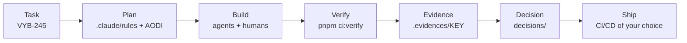

<div align="center">

<picture>
  <source media="(prefers-color-scheme: dark)" srcset="assets/banner-dark.svg">
  
</picture>

<a href="https://github.com/polubis"></a>

<sub>Built by <a href="https://github.com/polubis"><b>Adrian Połubiński</b></a> · <a href="https://polubinski.dev">polubinski.dev</a></sub>

**Generic ecosystem for full stack AI development: an incubator for new products and a sandbox for testing how AI agents build them, under strict, machine-checked rules.**

[](LICENSE)
[](.nvmrc)
[](https://pnpm.io)
[](https://astro.build)
[](https://www.typescriptlang.org)
[](https://workers.cloudflare.com)
[](https://github.com/polubis/gon-stack/actions/workflows/pr-ci.yml)

[Incubator + sandbox](#-incubator-and-sandbox) •
[Quick Start](#-quick-start) •
[Fork it](#-fork-it-and-make-it-yours) •
[Packages](#-packages) •
[How we work](#-how-we-work) •
[Agent skills](#-agent-skills-and-rules) •
[Structure](#-project-structure) •
[Contributing](#-contributing)

</div>

---

## 🧩 Incubator and sandbox

gon-stack is a **generic ecosystem for full stack AI development**, working as an **incubator + sandbox**.

- **Incubator.** Start a new product here: monorepo, shared packages, CI and agent workflow are wired up. Ideas grow into real apps, then ship from `main`.
- **Sandbox.** Rules, skills, agents and tooling are tried on live code, not on toy examples. What works stays, what does not gets cut.
- **Stack-agnostic by design.** Rules, skills, agents and gates are generic building blocks. They apply to any app you put under `apps/`, in any web stack.
- **AI ecosystem and tooling.** Agents work with the same gates as humans:

| Piece     | Where                     | What it gives                                                    |
| --------- | ------------------------- | ---------------------------------------------------------------- |
| Rules     | `.claude/rules/`          | Tagged, always-on standards (TypeScript, a11y, UX, styling, git) |
| Skills    | `.claude/skills/`         | Reusable workflows: planning, testing, evidence, reviews         |
| Agents    | `.claude/agents/`         | `boss`, `worker`, `doctor` roles                                 |
| nitpick   | `packages/nitpick`        | Keeps rule docs in sync with code, runs project checks           |
| vibe-test | `packages/vibe-test`      | E2E lib with type-safe selectors                                 |
| evidence  | `.claude/skills/evidence` | Proof videos and screenshots per task                            |
| decisions | `decisions/`              | One decision entry per session                                   |

---

## 🔁 Workflow



---

## 🚀 Quick Start

Requires Node `24.22.1` (see `.nvmrc`) and pnpm `11.28.5`.

```bash
pnpm install
pnpm dev                          # all apps via turbo
pnpm --filter <app> dev           # one app
```

| What you're doing | Command                            | Key principle                 |
| ----------------- | ---------------------------------- | ----------------------------- |
| Run everything    | `pnpm dev`                         | One command, all apps         |
| Unit tests        | `pnpm test`                        | Behavior, not internals       |
| E2E tests         | `pnpm pw:install && pnpm test:e2e` | Runs against the built worker |
| Lint + types      | `pnpm lint && pnpm check-types`    | Strict TypeScript             |
| Full CI locally   | `pnpm ci:verify`                   | Format, lint, types, test, build (pre-commit) |
| E2E before ship   | `pnpm ci:e2e`                      | PR gate coming; not on commit yet |
| Rules in sync     | `pnpm nitpick:check`               | Docs match code               |
| Format            | `pnpm format`                      | Prettier + Tailwind plugin    |

<details>
<summary><b>Apps with Supabase (Docker needed)</b></summary>

<br>

Apps that use the bundled Supabase setup need Docker:

```bash
pnpm db:start        # Postgres + Auth + Studio
pnpm db:reset        # apply migrations
pnpm db:gen-types    # regenerate DB types
```

Copy `.env.example` and `.dev.vars.example` where an app ships them.

</details>

---

## 🍴 Fork it and make it yours

1. **Fork** the repo (or use it as a template).
2. **Remove the sample apps** from `apps/` (and their `deploy-*.yml` workflows).
3. **Add your own app** under `apps/` in any web stack: Astro, Next.js, Vite, SvelteKit, plain TypeScript, anything pnpm and Turborepo can run.
4. **Everything applies to it:** rules, skills, agents, nitpick checks, `ci:verify`, evidence and decision log work per app, no matter the framework. Trim rules you do not need in `.claude/rules/`.

Shared packages stay available: use them, swap them or delete them.

---

## 🧱 Packages

| Package                                                 | Purpose                                                            |
| ------------------------------------------------------- | ------------------------------------------------------------------ |
| [`@repo/uih`](packages/uih)                             | Headless React UI, parts API (`Button.Root`), native element first |
| [`@repo/paker`](packages/paker)                         | Tiny state manager, zero runtime deps, subpath imports             |
| [`@repo/react-kit`](packages/react-kit)                 | React utils: `cn`, Context API helpers                             |
| [`@repo/type-beast`](packages/type-beast)               | Shared TypeScript types                                            |
| [`@repo/vibe-test`](packages/vibe-test)                 | Internal e2e lib, type-safe selectors                              |
| [`@repo/nitpick`](packages/nitpick)                     | Keeps AI rule docs (AODI) in sync with code, runs project checks   |
| [`@repo/ui`](packages/ui)                               | Shared component library                                           |
| [`@repo/astro-config`](packages/astro-config)           | Shared Astro config                                                |
| [`@repo/tailwind-config`](packages/tailwind-config)     | Shared Tailwind styles and tokens                                  |
| [`@repo/eslint-config`](packages/eslint-config)         | Shared ESLint configs                                              |
| [`@repo/typescript-config`](packages/typescript-config) | Shared `tsconfig` bases                                            |

---

## 🛠️ How we work

1. **Tracker key first.** Every change maps to a task (`VYB-245`) used in commits, decisions and evidence.
2. **Rules are code.** `.claude/rules/` holds tagged rules: `A` always, `I` infer, `O` optional, `D` on request. `nitpick` checks them.
3. **Rich commits.** `type(scope): title`, blank line, `- ` change list. Scope is required, `!` marks a breaking change.
4. **One decision per session.** A new file in `decisions/YYYYMMDD-HHmmss-<ticket>-<slug>.md` records what changed and why.
5. **Proof, not claims.** Cheapest sufficient evidence (test, screenshot, video) saved under `.evidences/<KEY>/`, never committed.
6. **CI gate.** Husky runs `ci:verify` (format, lint, types, unit tests, build) and `audit:check` before commit. Run `pnpm ci:e2e` locally; PR quality checks will add e2e soon.

---

## 🤖 Agent skills and rules

`.claude/` is the agent workspace.

| Path                  | Contents                                                                                    |
| --------------------- | ------------------------------------------------------------------------------------------- |
| `.claude/CLAUDE.md`   | Entry point, rule index                                                                     |
| `.claude/rules/`      | Git, testing, UX, UI, a11y, security, styling, TypeScript, React, Astro, Supabase           |
| `.claude/references/` | AODI framework, frontend architecture                                                       |
| `.claude/skills/`     | Reusable workflows: `evidence`, `plan-*`, `black-box-tester`, `sloth`, `witch-doctor`, more |
| `.claude/agents/`     | `boss`, `worker`, `doctor` roles                                                            |

<details>
<summary><b>Rule highlights</b></summary>

<br>

- Strict TypeScript
- Design tokens, no raw `px` or colors
- WCAG 2.2, full keyboard navigation
- Mobile first, dark mode
- No barrel exports
- `msw` for backend mocks
- Every Supabase error through `fromSupabaseError`

</details>

---

## 🗂️ Project structure

```
apps/        your apps, any web stack (sample apps included)
packages/    shared libraries and configs
decisions/   one decision entry per session
scripts/     repo tooling
assets/      README brand assets
.claude/     rules, skills, agents, references
.nitpick/    rule sync config
.github/     PR CI and deploy workflows
```

Typical app layout: `src/core`, `src/modules/<feature>`, `src/pages`, `src/__e2e__`.

---

## ⚙️ Tech stack

Defaults, all replaceable: Turborepo, pnpm workspaces, TypeScript, Astro, React, Tailwind CSS, Supabase, Cloudflare Workers, Zod, Vitest, Playwright, MSW, ESLint, Prettier, Husky.

---

## 🤝 Contributing

Create a branch from `main`, keep changes minimal, follow nearby conventions, run `pnpm ci:verify`, add one decision entry, open a PR. CI must pass.

---

## 👤 Author

Created and maintained by **Adrian Połubiński** ([@polubis](https://github.com/polubis), [polubinski.dev](https://polubinski.dev)).

---

## 📄 License

[MIT](LICENSE) © 2026 Adrian Połubiński. Free to use, copy, modify and distribute.

<div align="center">
<br>
<a href="https://greenonsoftware.com">
  <picture>
    <source media="(prefers-color-scheme: dark)" srcset="assets/greenon-logo-dark.svg">
    
  </picture>
</a>
</div>
