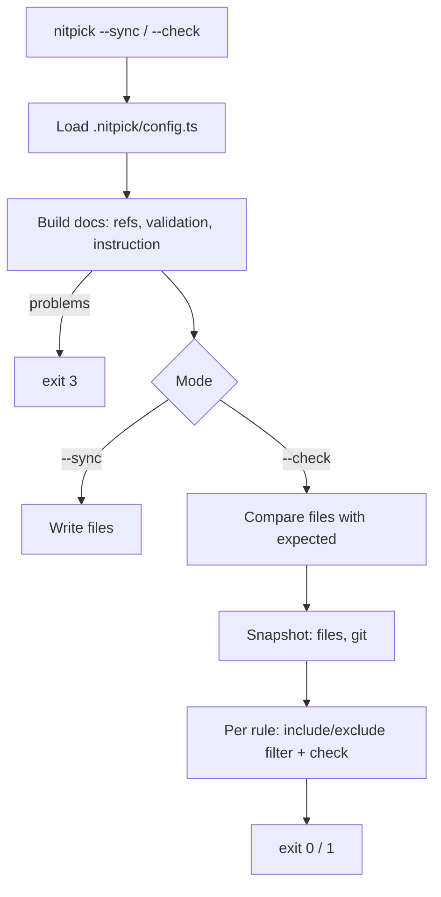

# @repo/nitpick

Keeps AI rules documentation (AODI format) in sync with the code, and runs project checks from the same rule definitions. Config lives in `.nitpick/config.ts`.

## Status

Implemented:

- `--sync` and `--check` (default) modes, exit codes 0/1/2/3
- AODI docs output (default `.ai/AGENTS.md`)
- `refs` with `file()` and `{{ref:key}}` inside ref files; typed `ref()` between rules and agents
- Config validation: missing file, self reference, unknown ref, cycle, duplicate rule `id`
- Check snapshot: `files`, `readText`, `git`, `meta`
- Per-rule `include` / `exclude`
- Typed `doc` forms: string, `{ file }`, or callback with `ref` / `file` / `insert`
- Ready-made rules: `richCommit`, `decisionLog`
- Claude Code settings: `settings` option generates `settings.json` / `settings.local.json` and `.mcp.json`

Covered by tests: 100% statements, branches, functions and lines (enforced by `test:coverage`; `cli.ts` is excluded).

Not wired yet:

- nitpick is not called from `.husky` hooks or GitHub workflows.

## Rules

Rules live under `rules.<group>.<id>`. Group = key, id = key, nothing else to author.

- `importance`: `A | O | D | I`, required. Printed as tag, e.g. `1. (I) text`.
- `doc`: see [Doc forms](#doc-forms). A `{ file }` doc is written to `<path>/rules/<id>.md` and linked as `N. (A) [id](id.md)`; string and callback docs are inlined in the group file.
- `run`: optional check script (was `check`). Gets `CheckContext`. Needs `fix`.
- `fix`: text after the problems of the rule (`Fix: ...`). Required with `run`.
- `include` / `exclude`: globs (`path.matchesGlob`) filtering `files` passed to `run`.
- Group files: rules of one group go to `<path>/rules/<group>.md`, groups in order of first key. Group name: letters, digits, `_`, `-`; must not equal a rule id with file doc.
- Ids unique across all groups, agents and skills. Duplicate = `config()` throws `Duplicate unit id "x"`; raw configs get `Duplicate id "x"` from verification (exit 3).
- Rules run in config order.

## Configuration

```ts
// .nitpick/config.ts
import { config } from '@repo/nitpick/config';
import { richCommit } from '@repo/nitpick/rules/rich-commit';

export default config({
  output: [{ path: '.claude', root: 'CLAUDE.md' }], // default: [{ path: '.ai', root: 'AGENTS.md' }]
  entry: { doc: ({ header, ref }) => `${header}\n\n${ref('react-hooks')}` },
  settings: { permissions: { allow: ['Bash(pnpm test:*)'] } },
  rules: {
    git: { 'rich-commit': richCommit },
    react: {
      'react-hooks': {
        importance: 'A',
        include: ['apps/*/src/**/*.tsx'],
        doc: ({ ref, file }) =>
          `Follow ${file('react-state')}, then ${ref('rich-commit')}.`,
        run: ({ files, readText, report }) => report('message'), // exit 1
        fix: 'How to correct it, with an example',
      },
    },
  },
  agents: {
    repo: { doc: 'Repo agent' },
    claude: {
      doc: ({ ref }) => `Use ${ref('repo')} and ${ref('react-hooks')}`,
    },
  },
  skills: {
    review: {
      frontmatter: { name: 'review', description: 'Review a diff' },
      doc: ({ ref }) => `Check ${ref('react-hooks')}`,
    },
  },
  refs: { 'react-state': './knowledge/react/state.md' },
});
```

- Ids come from keys. `ref(id)` takes the union of all rule, agent and skill ids (typo = compile error). `file(key)` takes the union of `refs` keys. Inferred, no manual generics.
- `ref(id)` links to the file that documents the unit (group file, rule file, `agents/<id>.md` or `skills/<id>/SKILL.md`). It never inlines, so cycles are harmless and cannot hang.
- Unknown or extra fields, missing `importance`/`doc`, `run` on an agent, `run` without `fix`: compile errors.
- `entry.doc` replaces header and intro of the root file (`header` = `# Information for AI`).
- Override a ready-made rule by spreading it: `{ ...richCommit, importance: 'D' }`.
- `agents`: each writes `<path>/agents/<id>.md` and is listed under `## Agent files` in the root. Optional `frontmatter: Record<string, string>` renders as a `---` block before the doc. No `run`. Agent ids are typed even when every agent `doc` is a callback.
- `skills`: same shape as `agents` (`doc`, optional `frontmatter`, no `run`); each writes `<path>/skills/<id>/SKILL.md` and is listed under `## Skill files` in the root.
- `refs`: id -> markdown file (relative to `.nitpick/`), written to `<path>/references/<key>.md`; `{{ref:key}}` links inside files; missing file, self ref, unknown ref, cycle = config error.

### Docs

Without `entry` the root docs start with `# Information for AI`. The built-in AODI tag legend (`src/rules/aodi-framework.md`, not configurable) is always written under `## Rule files`, above the file list. `entry.doc` replaces the head only.

- Group file title comes from the group key: split on `-`, words capitalized (`unit-testing` -> `Unit Testing`).

### Doc forms

Same for rules, agents, skills and `entry`:

- `string`: used as is.
- `{ file: './path.md' }`: content of the file, CRLF normalized to LF, `{{ref:key}}` replaced by links to `refs` keys. Missing file = verification problem (exit 3).
- `(ctx) => string`: `ctx` has `ref(id)` (rule or agent id), `file(key)` (`refs` key) and `insert(key)` (`refs` key). `entry` also gets `header`.
- `insert(key)` inlines the content of the `refs` file at generation time (trimmed, CRLF normalized, `{{ref:key}}` replaced); `file(key)` only links it. Missing file = verification problem (exit 3) and an empty string is inlined.
- Base of every path (`doc` files, `refs`): the `.nitpick/` directory; absolute paths allowed.

### Output

- With `settings`, `<name>` is written under the first `output` entry; `.mcp.json` goes to the project root. Other entries are unaffected. `--check` reports them as `[sync] <path> is out of date, run nitpick --sync`.
- The first `output` entry gets the full docs: `<path>/<root>` (root docs), `<path>/rules/<id>.md` (file instructions) and `<path>/references/<key>.md` (knowledge). Every next entry is a single file with `Follow instructions here: [<first root>](<relative path>)`.
- `ref(id)` / `file(key)` in `doc` become markdown links relative to the file that holds them. Unknown id or key is a config error.
- `{{ref:key}}` in a knowledge file becomes a link relative to that file.
- Source paths in `refs` are relative to `.nitpick/`. `output.path` and globs are relative to the project root.

### Settings

Optional top-level `settings` (inline object only) generates Claude Code settings.

- `name`: `settings.json` (default) or `settings.local.json`. Other value is a config error.
- `permissions`, `hooks`, `env` are typed; any other key passes through unchanged.
- `mcp`: `Record<name, McpServer>`. Stdio `{ command, args?, env? }` or remote `{ type: 'http' | 'sse', url, headers? }`. Empty server name is a config error.
- `name` and `mcp` are not emitted into the settings JSON. When `mcp` has servers, `.mcp.json` (`{ "mcpServers": {...} }`) is written at the project root and `enabledMcpjsonServers: [names]` is added to the settings file, because Claude Code reads project MCP servers from `.mcp.json`.
- Secret heuristic (config error, exit 3) for `env` values and MCP `env` / `headers` values: a value without `${VAR}` (or `${VAR:-default}`) expansion is rejected when its key matches `token|secret|key|password|passwd|auth|credential|bearer` (case-insensitive) or the value looks like a token (optional `Bearer ` plus 20+ chars of `[A-Za-z0-9_-./+=]`).
- Output: deterministic JSON (2-space indent, trailing newline, key order as in config).

### CheckContext

| Field                       | Description                                                                                                                                                                                                                                                 |
| --------------------------- | ----------------------------------------------------------------------------------------------------------------------------------------------------------------------------------------------------------------------------------------------------------- |
| `files`                     | Files from `git ls-files --cached --others --exclude-standard`, sorted, without tracked files deleted from disk, filtered by the rule's `include` / `exclude`. Globs follow `path.matchesGlob`, so `**` does not enter dot folders: use `.ai/**` explicitly |
| `readText(file)`            | Reads UTF-8 text (path relative to project root), cached per run                                                                                                                                                                                            |
| `git.commitMessages`        | Last commit by default; `--commit-msg <file>` uses file content; `--range <a..b>` uses commits in range (invalid range = exit 2)                                                                                                                            |
| `git.stagedAddedFiles`      | Files newly added to the index (`git diff --cached --diff-filter=A`), sorted, filtered by the rule's `include` / `exclude`. Git rename detection applies: a moved file that was rewritten a lot is reported as added                                        |
| `git.stagedFiles`           | All files changed in the index (`git diff --cached --name-only`), same sorting and filtering                                                                                                                                                                |
| `git.lastCommitMessages(n)` | Last `n` commit messages                                                                                                                                                                                                                                    |
| `report(message)`           | Reports a problem as `[ruleId] message`                                                                                                                                                                                                                     |
| `meta`                      | `{ ruleId, projectRoot }`                                                                                                                                                                                                                                   |

## CLI

```text
nitpick [--sync | --check] [--commit-msg <file>] [--range <a..b>]
```

Root scripts:

```json
{
  "nitpick": "nitpick",
  "nitpick:sync": "pnpm nitpick --sync",
  "nitpick:check": "pnpm nitpick --check"
}
```

- Loads `<cwd>/.nitpick/config.ts`.
- `--sync`: validates config, writes docs and knowledge files. Does not run `check`.
- `--check` (default): reports generated files that differ from disk (`[sync] ... is out of date, run nitpick --sync`), then runs each rule's `check`. Writes nothing.
- `--sync` together with `--check` is a usage error.

| Exit | Meaning                                                                                                        |
| ---- | -------------------------------------------------------------------------------------------------------------- |
| 0    | OK                                                                                                             |
| 1    | Problems: outdated files, `report` from a `check`, or a `check` that threw (`[id] check failed: ...`)          |
| 2    | Usage error or unreadable input (bad flags, missing `--commit-msg` file, invalid `--range`, no git repository) |
| 3    | Config error (import failure, validation, refs)                                                                |

When a rule reports problems, `--check` prints them as `[id] message`, then guidance for an LLM, once per failing rule:

```text
[rich-commit] Footer, trailer, reference or credit not allowed, found "Refs: #1"
Violated rule: rich-commit. Read .ai/rules/rich-commit.md
Fix: Rewrite the commit message as ...
```

The path is the rule file (`<path>/rules/<id>.md`) for a `{ file }` doc, otherwise the group file (`<path>/rules/<group>.md`). `Fix:` is the rule `fix` text.

Where to run it (commit hook, pre-push, CI) is up to the consumer.

## `richCommit` rule

Id `rich-commit`, importance `A`. Its instruction lives in the library (`src/rules/rich-commit.md`, next to the rule; `.md` files in `src/rules` are copied to `dist` on build) and is generated as `rules/rich-commit.md`. Validates `git.commitMessages`:

- Subject `type(scope)!: title`; types: `feat fix docs style refactor perf test build ci chore revert`; scope required.
- Blank line after the subject.
- Body contains at least one `- ` change list item.
- Body is only a `- ` list (nested ` -` items allowed). Nothing may follow it: no blank lines, prose, footers, `Key: value` trailers, references (`Refs`, `Fixes`, `Closes`), `Co-authored-by`, `Signed-off-by` or AI credits.

## `decisionLog` rule

Factory `decisionLog({ scopes })`, id `decision-log`, group `general`, importance `A`. Instruction `src/rules/decision-log.md`. `scopes`: regexes a `scope` must match (see `.nitpick/config.ts`). Validates `git.stagedAddedFiles` / `git.stagedFiles` (works with `--commit-msg`, i.e. in the `commit-msg` hook):

- Exactly one newly staged file `decisions/NNNN-<scope-prefix>-<verb>-<object>.md`. New files under any `__log__/` are reported as wrong location. A commit that only touches `decisions/` files (moves, edits) needs no new entry.
- Name: `NNNN` = max existing + 1, slug `[a-z0-9-]` 8-60 chars, starts with the first `scope` segment, then a verb from the allow-list (`VERBS` in the rule), then an object.
- Frontmatter (strict flat YAML subset: `key: value`, inline `[a, b]` or `- a` lists, plain or double-quoted scalars; no external parser, the rule needs nothing more): required `ticket` (`none` or `ABC-123`), `scope`, `summary` (10-70 chars), `why` (10-200 chars); optional `date`, `supersedes` (existing `NNNN`), `tags` (kebab-case), `models`, `inputTokens`, `outTokens`, `cost`, `workTimeInMinutes`. Unknown or duplicate keys fail.
- Body: 1-40 lines, each a `- ` item of max 240 chars, nested by 2 spaces (one level deeper at most). No heading, prose, code fence, blank line or empty bullet.
- Git rename detection: a `__log__` -> `decisions/` move whose content was rewritten a lot is reported by git as added file. Move first with unchanged content (pure rename, no entry needed), then edit in a second commit.

## Flow



The engine gives repeatable input and stable result order. A `check` must avoid depending on time and network if its result is to stay deterministic.

## Package

- Built-in references: `import { aodiFramework } from '@repo/nitpick/rules/aodi-framework'` gives the absolute path of the framework doc (`src/rules/aodi-framework.md`; copied to `dist` with the other `.md` files in `src/rules`); use it as a `refs` value: `refs: { 'aodi-framework': aodiFramework }`, then `file('aodi-framework')` / `insert('aodi-framework')`.
- Imports: `@repo/nitpick/<module>` (`config`, `rules/rich-commit`), exported from `dist`.
- Bin: `nitpick` (`dist/cli.js`).
- Scripts: `build`, `dev`, `check-types`, `lint`, `test`, `test:coverage`.
